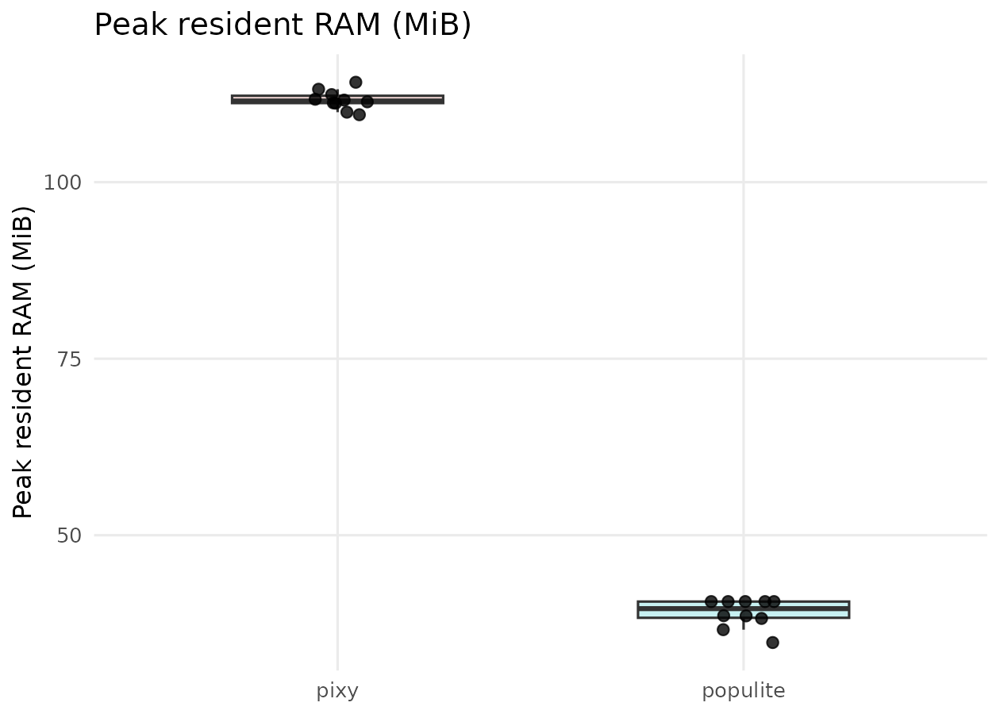
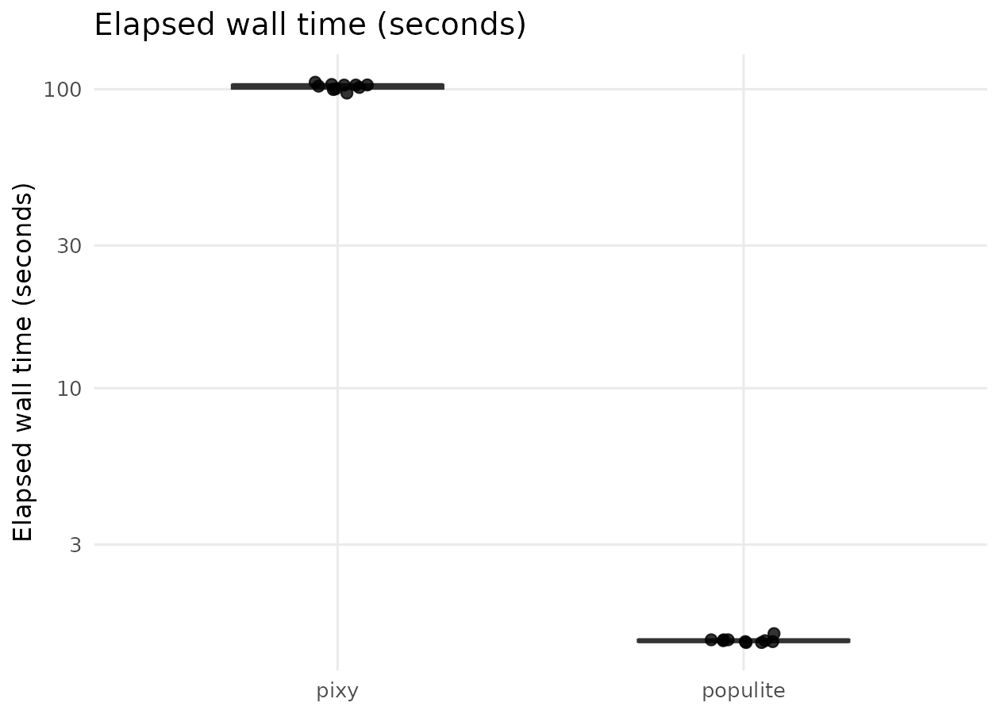
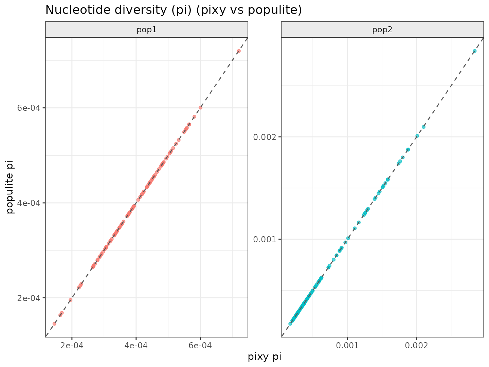
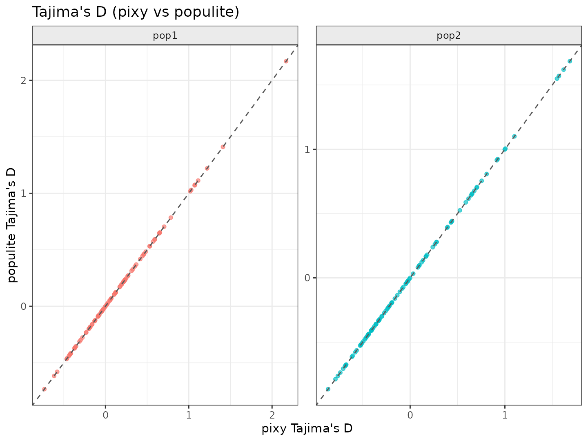
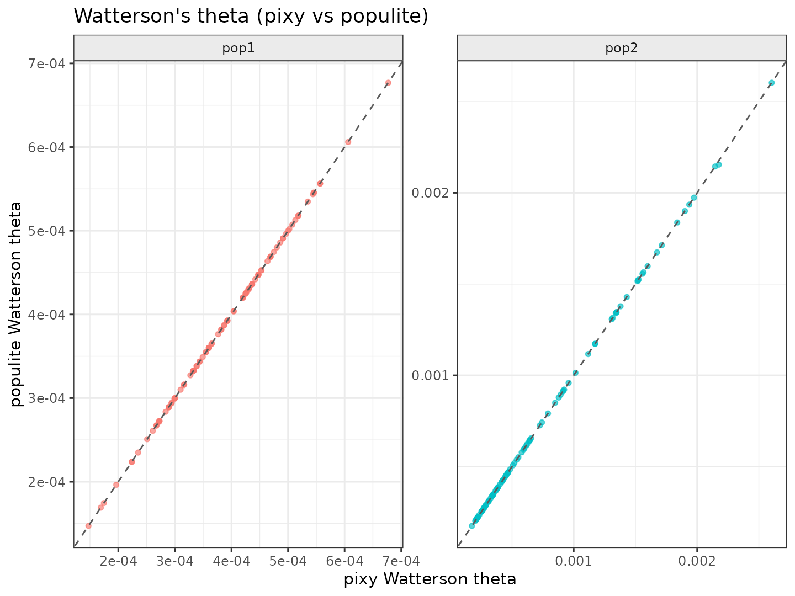
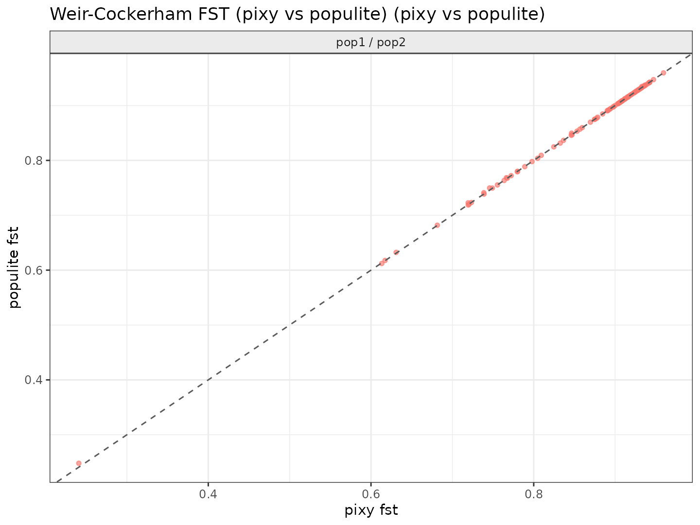
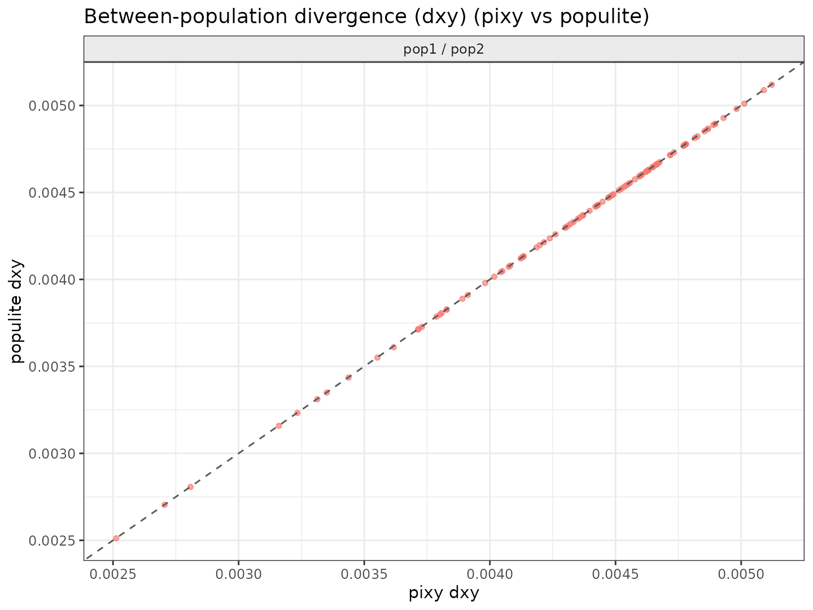

# Populite

## Lightweight and fast estimates of within population diversity and between population differentiation and divergence from single nucleotide polymorphism data and mappability masks

Populite estimates unbiased estimates of several commonly used population
genetic statistics: $\pi$, Heterozygosity, Tajima's D, F<sub>ST</sub>,
D<sub>XY</sub> and $\theta_W$. The only input needed is a bgzipped and indexed
vcf file, one mask file per sample defining callable regions (listed in the
mask table), and one file assigning the samples to be included to populations.

Requirements: python package [`numpy`](https://numpy.org/) and
[`bcftools`](https://samtools.github.io/bcftools/).

## Getting started

### Manage dependencies with conda

```bash
git clone https://github.com/axeljen/populite
cd populite
# make main script executable
chmod +x populite.py
conda create -n populite numpy bcftools
conda activate populite

```
## Usage

```bash
./populite.py --vcf <input_snps.vcf.gz> \
    --masks <mask_table.tsv> \
    --pops <populations.tsv> \
    --out results
```

Where

- `<input_snps.vcf.gz>` is the bgzipped and indexed VCF file containing the SNP
  data.
- `<mask_table.tsv>` is a two-column tab-separated file with one row per
  sample, specifying the sample name and the path to the corresponding mask
  file.
- `<populations.tsv>` is a two-column tab-separated file assigning samples to
  populations, with one row per sample specifying the sample name and the
  population it belongs to.
- `results` is the prefix for the output files where the results will be
  written. Two files per statistic will be generated: one containing the
  estimates in sliding windows across the genome (defaults to 100kb), and one
  containing the genome-wide estimates for each population/population pair.

A toy dataset is provided in the `examples` directory. To run this example:

```bash
cd examples
../populite.py --vcf filtered_snps.vcf.gz \
    --masks maskfiles.tsv \
    --pops populations.tsv \
    --out results
```

## Detailed options

| Option | Required | Default | Description |
| --- | --- | --- | --- |
| `-h`, `--help` | No | — | Show the command-line options and exit. |
| `--vcf PATH` | Yes | — | Input SNP VCF or BCF. VCFs must be bgzipped and indexed so `bcftools` can query them. |
| `--masks PATH` | Yes | — | Two-column, tab-separated table: sample ID and path to that sample's callable-region BED mask. BED intervals use 0-based, half-open coordinates; `.gz` masks are supported. |
| `--pops PATH` | Yes | — | Two-column, tab-separated table: sample ID and population ID. Samples listed here must occur in the VCF and have a mask. |
| `--out PREFIX` | Yes | — | Prefix for result files. Selected statistics are written as windowed and genome-wide TSV files, for example `PREFIX.pi_windows.tsv` and `PREFIX.pi_genomewide.tsv`. |
| `--stats STAT [STAT ...]` | No | `pi het` | Space-separated statistics to estimate: `pi`, `het`, `dxy`, `fst`, `watterson_theta`, and/or `tajima_d`. By default only `pi` and `het` are calculated. `dxy` and `fst` require at least two populations. WC `fst` requires diploid genotypes. |
| `--window-size BP` | No | `100000` | Window width in base pairs. The final window on a chromosome may be shorter. |
| `--chroms CHROM[,CHROM...]` | No | All chromosomes with mask data | Comma-separated chromosome or contig names to analyze, for example `chr1,chr2`. Names must match the VCF and BED files. |
| `--chroms-file PATH` | No | None | File with one chromosome name per row (blank lines and full-line # comments ignored). |
| `--ploidy N` | No | `2` | Ploidy assumed for every sample and chromosome. WC `fst` is currently supported only with `2`. |
| `--chunk-size N` | No | `50000` | Maximum number of variant records queried at once. Smaller values use less temporary memory; larger values may reduce processing overhead. |

For example, to calculate all statistics in 50 kb windows on two chromosomes:

```bash
./populite.py --vcf input_snps.vcf.gz \
    --masks mask_table.tsv \
    --pops populations.tsv \
    --window-size 50000 \
    --chroms chr1,chr2 \
    --stats pi het dxy fst watterson_theta tajima_d \
    --out results
```

## Why populite?

Heterozygosity, pi and dxy should not be estimated from SNP data alone, as
information about invariant sites is needed to obtain unbiased estimates.
Golden standard has typically been to generate an all-sites VCF that includes
both variant and invariant sites, and then estimate these statistics with,
e.g., the widely used software [pixy](https://github.com/ksamuk/pixy). However,
generating, storing and processing all-sites VCFs is an annoying task, since
they are slow to generate, huge and thus cumbersome to work with. Furthermore,
the same information can easily be stored as intervals in a mask file, which
requires much less storage space and is more convenient to handle. Populite
estimates all the statistics that pixy does too, but much faster and from input
files that are a fraction in size.

### Comparisons with pixy

The toy example provided in the `examples` directory contains a simulated
dataset consisting of four individuals from two populations, mapped and
genotyped against a reference genome of 10 Mb in size. These files sum up to
**6.5 Mb**. The allsites vcf from this toy dataset that pixy would require is
**170 Mb**, so populite input files are ~5 % of the pixy input files. 

Furthermore, it is much faster to run, and use less RAM. Below is a benchmark
comparing populite and pixy on the toy dataset, estimating all available
statistics in both pixy and populite, running on a single core with 1.8 GB of
RAM available.




While computationally outperforming pixy, populite converges to almost identical
estimates for all shared statistics:







